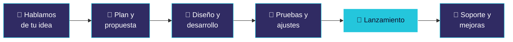

<!-- ═══════════════════════════════════════════════════════════════ -->
<!--                    README DE PERFIL · ANDRÉS TEJADA               -->
<!-- ═══════════════════════════════════════════════════════════════ -->

 

 

---

## 👋 ¡Hola! Soy Andrés Tejada

> **¿Tienes un negocio y todavía no estás en internet… o estás, pero haces todo a mano?**
> Ahí es donde entro yo. 🦸‍♂️

Ayudo a emprendedores y negocios a **tener presencia profesional en la red** y a **automatizar tareas repetitivas con inteligencia artificial**, para que ganen tiempo, clientes y tranquilidad.

Vengo de **casi 9 años en servicio al cliente y operaciones**, así que sé lo que es atender personas, resolver problemas reales y hacer que los procesos funcionen. Esa experiencia + desarrollo front-end + IA = soluciones pensadas para **negocios de verdad**, no solo código bonito. 💡

 

## 🛠️ ¿Qué puedo hacer por tu negocio?

<table>
<tr>
<td width="33%" valign="top">

### 🌐 Páginas Web
**Tu vitrina 24/7**

- Páginas de presentación y *landing pages*
- Portafolios y sitios corporativos
- Tiendas online y catálogos
- Diseño moderno, rápido y **adaptado a celular** 📱
- Optimizadas para que te encuentren en Google 🔎

</td>
<td width="33%" valign="top">

### 🤖 Agentes de IA
**Empleados que no duermen**

- Chatbots para atención al cliente
- Asistentes para WhatsApp, web y redes
- Agentes que responden, califican y agendan
- Entrenados con **la información de tu negocio**
- Personalizados a tu tono de marca 🎯

</td>
<td width="33%" valign="top">

### ⚡ Automatización
**Menos tareas, más ventas**

- Flujos automáticos entre tus herramientas
- Respuestas, correos y seguimientos automáticos
- Integración de formularios, CRM y hojas de cálculo
- Reportes y procesos sin trabajo manual
- Todo conectado, todo fluyendo 🌊

</td>
</tr>
</table>

 

## 🧩 ¿Cómo trabajamos juntos?

 

## 💻 Mi caja de herramientas

**Front-end & Web**

**Inteligencia Artificial & Automatización**

**Herramientas del día a día**

 

## ✨ ¿Por qué elegirme?

| | |
|---|---|
| 🎯 **Enfoque en resultados** | No hago páginas "bonitas y vacías": cada pieza tiene un objetivo (vender, captar, atender). |
| 🗣️ **Trato humano y claro** | Casi 9 años atendiendo clientes me enseñaron a escuchar y a explicar sin tecnicismos. |
| ⚙️ **Mente de operaciones** | Entiendo procesos, así que automatizo lo que realmente te hace perder tiempo. |
| 🇨🇴 **Cercano y local** | Conozco el mercado colombiano y hablo tu idioma, en todos los sentidos. |
| 🔄 **Mejora continua** | Tu negocio crece, tu web y tus agentes también. |

 

## 🚧 En construcción (y con estilo)

| 🔨 Proyecto | 📌 Estado |
|:---|:---:|
| 🌟 **Mi página personal / portafolio** (Vite + React + TypeScript) |  |
| 🤖 **Agentes de IA personalizados para negocios** |  |
| 🛍️ **Proyectos propios de comercio digital** |  |

 

## 📊 Mi actividad en GitHub

 

 

 

## 📬 ¿Hablamos?

**Cuéntame tu idea y te digo cómo hacerla realidad.** 🚀

  

> ☕ **Primera consulta sin compromiso.**  
> Tú pones la idea, yo pongo el código y la IA. 🤖

